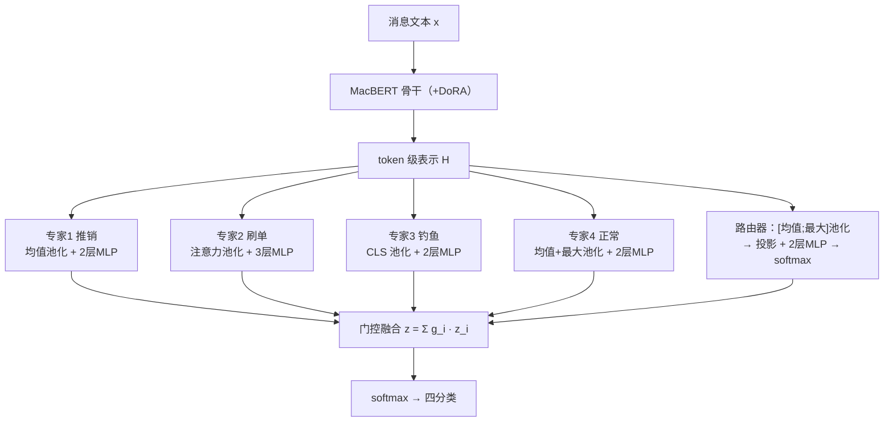

# 基于多专家门控融合 BERT 的校园网络诈骗文本识别系统

## 摘要

针对校园网络诈骗中高发的推销、刷单、钓鱼三类话术在文本风格上的显著差异，本文提出并实现了一种基于多专家门控融合 BERT 的中文诈骗文本四分类系统（正常 / 推销 / 刷单 / 钓鱼）。系统以中文预训练模型 MacBERT 为骨干，采用 DoRA 参数高效微调；核心创新是**输出级异构专家融合架构**：四个分别面向不同诈骗类型话术特征的专家网络（池化策略与网络结构各异）共享骨干表示，各自对自己负责的类别施加损失加权 λ=3 实现分工，由可训练门控路由器软融合输出；训练采用 Branch–Adapt–Route 三阶段流程（MLM 继续预训练 → 单头微调 → 冻结骨干训练专家 → 路由训练与联合微调）。在 327,232 条多源中文消息（含说话人分离转写并脱敏入库的 13,388 条电信诈骗通话）上的实验表明：完整系统 test Macro-F1 达到 **0.8835**（95% 置信区间 [0.846, 0.909]），显著优于 DoRA 单头微调基线（0.7998，McNemar 检验 p≈3.7×10⁻³⁷）与 TF-IDF+逻辑回归传统基线（0.6609）；融合方式消融显示增益来自多专家互补表示与软融合（top-1 硬选择下降 7.6 个百分点）。系统导出为单图 ONNX 模型，通过任务式异步 API 提供预测与 token 级归因（Occlusion 留一法）服务，CPU 单条预测约 28 ms。

**关键词**：诈骗文本识别；混合专家；门控融合；MacBERT；参数高效微调；ONNX 部署

## 1 引言

我校学生遭受网络诈骗的人数长期居全市高位，高发类型集中在三类：**推销诈骗**（冒充师生混入课程群、班级群私聊或群发推销，常伴"已向管理员报备"等迷惑措辞与色情引流）、**刷单诈骗**（以小额返利诱导，逐步升级垫付任务）、**冒充学校与教师的钓鱼**（诱导填写学号、身份证、银行卡等敏感信息）。三类诈骗在话术风格与文本结构上差异显著（推销口语化碎片化、刷单呈"小额返利→逐步升级"的渐进式语义结构、钓鱼采用正式公文口吻），但**共同载体都是文本**。

基于这一观察，本文将输入限定为纯文本（群聊/私聊消息、短信、邮件正文），不解析 URL、不抓取网页、不做流量分析：三类诈骗的判定核心在话术本身，真实消息中 95% 以上为纯文本，且离线可部署的文本链路在演示与生产环境中可靠性最高。本文的主要工作与贡献如下：

1. 提出并实现**面向诈骗类型分工的输出级异构专家门控融合架构**，以损失加权（λ=3）与数据侧重采样显式建立"专家—类别"分工，避开将标准 MoE 层插入 BERT 中间层带来的路由震荡、负载塌缩与预训练表示破坏问题；
2. 完成**多源数据体系的构建与治理**：10 个公开数据集经映射、去重、分层划分为 32.7 万条四分类训练池，其中电信诈骗通话经说话人分离 ASR 转写与 PII 脱敏后入库，全部来源与许可证可追溯；
3. 完成**系统化对比与统计检验**：与传统基线（TF-IDF+朴素贝叶斯/逻辑回归）、PEFT 变体（LoRA/DoRA 单头）及完整系统在同一数据划分下对比，报告 bootstrap 置信区间与 McNemar 显著性，并进行融合方式消融；
4. 实现**可解释的轻量部署**：PEFT 权重合并后导出单图 ONNX，任务式异步 API 提供预测、专家权重可视化与 Occlusion token 级归因，无需 GPU 与 torch 运行时。

## 2 相关工作

**诈骗文本检测**。ChiFraud [8] 构建了长期演化的中文欺诈检测语料；JMoE-FAP [6] 将混合专家与点积注意力结合用于电信诈骗受害过程分析，验证了"MoE + 中文反诈文本"组合的有效性；CAMERA [7] 针对语义伪装问题采用自我解耦的 MoE 架构，每个专家专门建模一种欺诈指示信号，与本文"每个专家学习一类诈骗话术"的分工思路与其一致，但将专家融合放在输出层而非编码器内部。

**中文预训练模型与参数高效微调**。MacBERT [1] 是中文 BERT 的改进变体（whole word masking + NLI 监督）；LoRA [2] 以低秩增量 $W = W_0 + BA$ 冻结底座只训练增量；DoRA [3] 进一步将权重分解为幅度与方向两个分量（$W' = m \cdot \frac{W_0 + BA}{\|W_0 + BA\|_c}$），在低秩预算下逼近全量微调效果。本文主路径采用 DoRA（r=8，约 47 万可训练参数，占全模型 0.46%），并以 LoRA 单头作为 PEFT 变体对照。

**稀疏专家与负载均衡**。Switch Transformer [4] 提出以辅助损失 $\sum_i f_i \cdot p_i$ 鼓励专家负载均衡，本文将其用于输出级路由器以防止路由塌缩。模型校准以 ECE [5] 度量。

## 3 方法

### 3.1 问题定义

给定消息文本 $x$，预测四分类标签 $y \in \{0{=}\text{正常},\ 1{=}\text{推销},\ 2{=}\text{刷单},\ 3{=}\text{钓鱼}\}$。所有输入统一截断至 128 token。

### 3.2 总体架构

系统由 MacBERT 骨干、4 个异构专家、门控路由器三部分组成：



骨干输出 token 级隐藏状态序列 $H \in \mathbb{R}^{L \times d}$（$d=768$）。专家 $i$ 先以自己的池化算子 $p_i$ 将 $H$ 池化为单一向量，再经 MLP 头输出完整的 $C=4$ 维 logits：

$$
z_i = E_i\big(p_i(H)\big) \in \mathbb{R}^{C}, \quad i = 1,\dots,M\ (=4)
$$

池化策略即专家的"视角"：均值池化捕捉整体语义分布，注意力池化（单头可学习查询）聚焦高显著性片段，CLS 表示偏向全局公文式语义，均值+最大拼接兼顾平铺与峰值特征。专家层直接消费 token 级 $H$ 而非预池化向量——若先池化再分发，专家差异只剩 MLP 结构，多视角分工便无从谈起。

路由器对 $H$ 做均值与最大池化拼接后，经线性投影、LayerNorm、Dropout 与 2 层 MLP 输出 M 维门控权重：

$$
h_r = \big[\,p_{\text{mean}}(H);\, p_{\text{max}}(H)\,\big] \in \mathbb{R}^{2d}, \qquad
g = \text{softmax}\left(W_2 \cdot \text{ReLU}(W_1 \cdot \text{Dropout}(\text{LayerNorm}(W_p h_r)) + b_1) + b_2\right)
$$

最终融合 logits 与预测为：

$$
z = \sum_{i=1}^{M} g_i \cdot z_i, \qquad \hat{y} = \text{softmax}(z)
$$

**与标准 MoE 的关系**：标准 MoE 在 Transformer FFN 层插入多个同构专家并按 token 路由；本系统的"专家"是面向不同诈骗类型话术特征的异构分类网络，融合发生在输出层。不在 BERT 中间层插入 MoE 层，原因有三：token 级路由在训练初期震荡导致梯度不稳；部分层路由塌缩使专家梯度消失；替换预训练 FFN 会破坏已有表示能力。输出级融合规避以上全部风险，同时保留"按话术类型分工 + 门控自适应组合"的核心思想。

### 3.3 专家异构性与分工机制

专家在**网络结构、池化策略、训练数据侧重**三个维度差异化，**损失函数不参与异构化**——若各专家使用不同损失（Focal Loss 等），其 logits 尺度不可比，融合前需额外校准，徒增脆弱性。因此所有专家统一使用加权交叉熵。

| 差异化维度 | 推销专家 | 刷单专家 | 钓鱼专家 | 正常专家 |
| :--- | :--- | :--- | :--- | :--- |
| 网络结构 | 2 层 MLP，hidden 512 | 3 层 MLP，hidden 256 | 2 层 MLP，hidden 512 | 2 层 MLP，hidden 256 |
| 池化策略 | 均值池化 | 注意力池化（单头可学习查询） | CLS token | 均值+最大拼接 |
| 数据侧重 | 推销类约 3 倍过采样 + 表情插入增强 | 刷单类约 3 倍过采样 | 钓鱼类约 3 倍过采样 | 正常类约 3 倍过采样 |
| 分工机制 | $\lambda_{i,i}=3$（i=1） | $\lambda_{i,i}=3$（i=2） | $\lambda_{i,i}=3$（i=3） | $\lambda_{i,i}=3$（i=0） |

每个专家都是完整的 4 分类器（训练数据含全部四类），但专家 $i$ 的损失对其负责的类别 $i$ 加权 $\lambda_{i,i}=3$（其余类别权重 1）。缺少该机制时，所有专家见到相同数据与损失，路由器将学成近似均匀权重，门控融合退化为普通集成。实现中"专家—类别"绑定通过配置项 `experts[].self_class` 显式指定（推销→1、刷单→2、钓鱼→3、正常→0），与专家在配置列表中的顺序无关，避免下标巧合依赖；推理服务的专家命名从导出元数据 `predict_meta.json` 读取。

### 3.4 损失函数

专家 $i$ 的加权交叉熵为：

$$
\mathcal{L}_i = -\frac{1}{N}\sum_{n=1}^{N}\sum_{c=1}^{C} w_c \cdot \lambda_{i,c} \cdot y_{n,c}\log \hat{y}_{i,n,c}
$$

其中 $w_c$ 为全局类别权重（按训练集频率倒数归一化，处理类别不平衡），$\lambda_{i,i}=3$、$\lambda_{i,c\neq i}=1$。路由器训练使用融合输出的加权交叉熵（仅 $w_c$）加负载均衡损失：

$$
f_i = \frac{1}{N}\sum_{n=1}^{N} \mathbb{1}\left[\arg\max_j \, g_j^{(n)} = i\right], \qquad
p_i = \frac{1}{N}\sum_{n=1}^{N} g_i^{(n)}, \qquad
\mathcal{L}_{\text{bal}} = \alpha \cdot M \cdot \sum_{i=1}^{M} f_i \cdot p_i\ (\alpha = 0.01)
$$

$f_i$ 由硬分配统计（不参与梯度），梯度仅经软路由概率 $p_i$ 回传。总损失 $\mathcal{L} = \mathcal{L}_{\text{cls}} + \mathcal{L}_{\text{bal}}$，α 全程固定。路由器 softmax 温度固定为 1，不引入温度调度——温度调控与负载均衡损失的调控目标重叠，统一由 α 控制，超参更少、行为更可解释（事后温度缩放可作为部署期可选校准）。

### 3.5 三阶段训练 Branch–Adapt–Route

| 阶段 | 内容 | 可训练参数 | 关键设置 |
| :--- | :--- | :--- | :--- |
| 0（MLM 分支） | 80 万短信语料采样 20 万条做掩码语言模型继续预训练（2 epoch，lr 5e-5，掩码率 0.15），使骨干适配消息文体 | 骨干（含 DoRA） | 产物作为阶段 1 的初始化 |
| 1 Branch | 四分类单头微调（均值池化 + Linear；3 epoch，lr 2e-5，batch 32） | 骨干 + 单头 | 单头模型即对比实验中的"MacBERT+PEFT 单头"基线，与完整系统共享骨干 |
| 2 Adapt | 冻结骨干并置于 eval 模式（关闭其 dropout 保证表示确定性），逐个训练 4 个专家（各 4 epoch，lr 1e-3，batch 64），WeightedRandomSampler 对各自负责类别约 3 倍过采样 | 仅当前专家 | 每专家按 val Macro-F1 保留 best |
| 3 Route | 冻结骨干与全部专家，训练路由器 6 epoch（lr 1e-3）；随后联合微调 2 epoch（lr 5e-4）：解冻路由器与各专家模块（含注意力池化的可学习查询），骨干仍冻结以防灾难性遗忘 | 路由器 → 路由器+专家模块 | 监控激活比例 $f_i$ 与平均门控概率 $p_i$ 防路由塌缩 |

各阶段每 epoch 按 val Macro-F1 保存 best checkpoint，并落盘含优化器状态的续训点（`--resume` 支持按 epoch / 按专家粒度断点续训）。

### 3.6 Token 级归因系统

四分类结果之外，系统需要回答"模型为什么这样判"。为此设计并实现了 **Occlusion 留一法 token 级归因**，作为系统的可解释性组件。

**方法**。将输入按分词器的词单元分组（中文按字、英文与数字按整词，由分词器的 word 映射保证子词聚合正确），记去重后词数为 $N$。构造 $N+1$ 份输入副本：1 份基线 + $N$ 份遮蔽副本（第 $j$ 份将词 $j$ 的全部 token 替换为 `[UNK]`），拼成一个 batch 对现有 ONNX 前向图做**一次批量前向**，词 $j$ 的归因分数为：

$$
\text{score}_j = P_{\text{base}}(\hat{y}) - P_{\text{masked}_j}(\hat{y})
$$

其中 $\hat{y}$ 为基线预测类别。分数即"删除该词后模型对预测类别的置信度下降幅度"，语义直接可读（"删掉'垫付'，判为刷单的概率从 0.97 降至 0.41"）。

**选型理由**。梯度类方法（Gradient×Input 等）依赖自动微分，且 ONNX 推理图不含反向计算（onnxruntime 对 ONNX Gradient 算子支持极为有限），无法随模型一起导出；Occlusion 只需多次前向，可**纯 ONNX 实现**——零重训练、零新依赖、生产服务器无需 torch。其已知弱点是冗余线索会被低估（同义话术词并存时删一个词影响小），通过按去重词整体遮蔽缓解；实测中文话术中单字承载语义（"垫""付"），字级留一的分数仍能有效聚集到关键词上。

**第二视角**。刷单专家的池化为注意力型，其 token 注意力权重是天然的解释信号，导出时作为独立输出 `attn_scores` 一并导出，服务端作为第二归因视角返回；鉴于注意力权重的解释力随该专家门控权重降低而减弱，响应同时携带该专家的门控权重 $g_i$ 供消费方判断，两视角互为印证。

**健壮性与展示**。归因在服务端与主预测解耦：分词器不支持词级映射（离线测试桩）或归因过程异常时，自动降级为关键词匹配证据并标注来源字段（`occlusion` / `keyword_fallback` / `expert_attention`），不阻塞主结果。归因分数按去重词给出，同时返回相邻字合并后的**词组显示版**（"教/务/处"→"教务处"，分数累加）与各词的字符区间，供前端直接高亮。

## 4 实验设置

### 4.1 数据集

四分类训练池共 327,232 条，按分层随机划分（种子 42）为 train 270,471 / val 28,395 / test 28,366。类别分布：正常 160,330、推销 53,939、刷单 28,492、钓鱼 84,471。

| 类别 | 主要来源 |
| :--- | :--- |
| 正常 | FGRC-SCD 无风险、天池 label00（运营商营销短信，近领域负样本）、TeleAntiFraud 正常场景通话转写、spam10000 闲聊、LLMGen 中文正常邮件 |
| 推销 | CCL2023 虚假购物服务、FGRC-SCD 虚假购物服务、FBS_SMS 广告类、spam10000 群聊推广 |
| 刷单 | CCL2023 刷单返利类 28,353（受害人笔录文体）+ anti_fraud 兼职刷单对话 139 |
| 钓鱼 | 天池/FGRC-SCD/CCL2023 冒充类、TeleAntiFraud 冒充类通话、LLMGen/PhishMMF 中文钓鱼邮件、FBS 钓鱼短信 |

数据治理要点：TeleAntiFraud 的 13,711 条通话音频经说话人分离转写（paraformer-zh + fsmn-vad + ct-punc + cam++，逐句标注说话人）与 PII 脱敏（正则 + CLUENER NER 姓名识别，替换为 [电话] [证件号] [姓名] 等占位符）后入库；金额类短数字保留以保训练信号。各数据集经标签映射（宁缺毋滥，话术差异大的不强行映射）、全局去重后入库；全部来源、许可证与引用义务见仓库 `DATASETS.md`。

已知数据局限：CCL2023 镜像仅提供官方 train 文件，刷单类 28,353 条全部进入训练集，test 中刷单类仅 14 条——该类测试指标统计上脆弱；且其语料为受害人笔录（第三人称叙述），与消息文体存在域偏移。

### 4.2 对比方案与实现细节

| 方案 | 说明 |
| :--- | :--- |
| TF-IDF + 朴素贝叶斯 / 逻辑回归 | 传统基线：unigram+bigram TF-IDF |
| MacBERT + LoRA 单头 | PEFT 变体（r=8，α=16，target q/k/v） |
| MacBERT + DoRA 单头 | 主模型基线（阶段一产物） |
| 完整系统 MoE 门控融合 | 阶段三产物（骨干与基线共享） |

全部方案输入一致（纯文本、同分词器、max_length 128）、共享同一数据划分；类别不平衡由全局类权重（频率倒数）与阶段二过采样处理。硬件为 RTX 4060 Laptop 8GB（torch 2.14+cu130，transformers 5.14，peft 0.21）。模型选择仅依据 val Macro-F1，test 只用于最终评估。

### 4.3 评价指标

Accuracy、Macro-F1、按类 Precision/Recall/F1、混淆矩阵；校准以 10 区间 ECE 度量 [5]；Macro-F1 的 95% 置信区间由 1,000 次 bootstrap 重采样估计；同一 test 集上两模型的差异以 McNemar 精确二项检验与配对 bootstrap Macro-F1 差值检验。单种子（42）结果均附 bootstrap 置信区间而非单点值。

## 5 结果与讨论

### 5.1 主结果

| 方案 | Accuracy | Macro-F1 | 95% CI | ECE |
| :--- | ---: | ---: | :---: | ---: |
| TF-IDF + 朴素贝叶斯 | 0.8477 | 0.5917 | — | — |
| TF-IDF + 逻辑回归 | 0.8619 | 0.6609 | — | — |
| MacBERT + LoRA 单头 | 0.8941 | 0.7953 | [0.7415, 0.8381] | 0.0082 |
| MacBERT + DoRA 单头 | 0.8939 | 0.7998 | [0.7446, 0.8435] | 0.0080 |
| **完整系统 MoE 门控融合** | **0.9110** | **0.8835** | **[0.8456, 0.9094]** | 0.0105 |

完整系统相对最强单头基线 Macro-F1 提升 8.4 个百分点，相对 TF-IDF+逻辑回归提升 22.3 个百分点。两种 PEFT 单头（LoRA 0.7953 与 DoRA 0.7998）的置信区间完全重叠，单种子下不可区分。

### 5.2 按类分析

| 类别 | Precision | Recall | F1 |
| :--- | ---: | ---: | ---: |
| 正常 | 0.9788 | 0.9541 | 0.9663 |
| 推销 | 0.7747 | 0.8752 | 0.8219 |
| 刷单（n=14）⚠️ | 0.8667 | 0.9286 | 0.8966 |
| 钓鱼 | 0.8681 | 0.8315 | 0.8494 |

完整系统混淆矩阵（行=真实，列=预测；顺序 正常/推销/刷单/钓鱼）：

```
正常 [15729   414     1   341]
推销 [  180  4662     0   485]
刷单 [    0     1    13     0]
钓鱼 [  160   941     1  5438]
```

主要误差轴是**钓鱼↔推销**的相互混淆（941 与 485 条）——两类话术在消息文体下边界天然模糊（诱导性商业话术与钓鱼诱导结构相近）。与单头基线相比，完整系统同时收窄 正常→推销（517→414）、推销→正常（340→180）、钓鱼→推销（1,098→941）三条主要误判路径，未出现以牺牲某类换取另一类的跷跷板现象；两个单头模型对刷单类的 Precision 偏低（0.53–0.56，将大量非刷单消息误判为刷单），完整系统将其修复至 0.87。

### 5.3 统计检验

| 对比 | McNemar（n01 / n10 / p） | 配对 Macro-F1 差值（95% CI） | 结论 |
| :--- | :--- | :--- | :--- |
| MoE vs DoRA 单头 | 493 / 978 / 3.7×10⁻³⁷ | +0.085 [0.043, 0.136] | 显著优于单头 |
| MoE vs LoRA 单头 | 496 / 977 / 1.6×10⁻³⁶ | +0.090 [0.046, 0.140] | 显著优于单头 |
| LoRA vs DoRA | — | 置信区间完全重叠 | 单种子下不可区分 |

### 5.4 消融：融合方式

| 融合方式 | Accuracy | Macro-F1 | 95% CI | ECE |
| :--- | ---: | ---: | :---: | ---: |
| 门控加权（完整系统） | 0.9110 | 0.8835 | [0.8456, 0.9094] | 0.0105 |
| A1 等权平均 | 0.9105 | 0.8827 | [0.8444, 0.9085] | 0.0094 |
| A2 top-1 硬选择 | 0.8906 | 0.8076 | [0.7539, 0.8465] | 0.0196 |

门控软融合与等权平均在噪声内持平（差 0.0008），两者均显著优于 top-1 硬选择（下降 7.6 个百分点且校准同步恶化）。据此，本系统的增益来自**多专家互补表示与软融合机制**；路由器当前学到的动态权重与等权无显著差异，其价值体现在软融合框架、负载均衡的可控性与可解释输出（专家权重与意见可视化）。路由负载均衡健康：激活比例 $f_i$=[0.276, 0.152, 0.186, 0.386]，平均门控概率 $p_i$=[0.264, 0.196, 0.266, 0.274]，无专家塌缩。

阶段二各专家独立最佳 val Macro-F1 为推销 0.7816 / 刷单 0.8281 / 钓鱼 0.7886 / 正常 0.8048。刷单专家最高不能归因于其注意力池化——四个专家在层数、数据侧重与类别文体难度上均不同，该对照属混杂设计。

### 5.5 局限

1. **单种子**：全部数字为种子 42 单次训练附 bootstrap 置信区间；多种子重复的配置与命令已随仓库交付。
2. **刷单类测试脆弱**：test 仅 14 条且训练语料为受害人笔录文体，刷单指标仅作参考；实际测试中校园风格刷单话术可能被判为"推销"。
3. **域偏移评估待补**：训练语料来自短信、通话转写、邮件与笔录，面向"校园消息"目标文体的正式评估依赖人工构建的黄金测试集（位置与生成规范已预留于仓库）。
4. **未进行的对照**：全量微调单头（受 8GB 显存限制需 batch 16）与同构专家（A3）、专家数 M=2（A4）、阶段一监督消融（A5）、合成数据（A6）等消融未纳入本轮实验。

## 6 系统实现与部署

### 6.1 模型导出

阶段三 checkpoint 的 PEFT 权重合并回骨干后，导出为单图 ONNX：输入 `input_ids`/`attention_mask`，输出融合 `logits`、门控 `gate`、各专家 `expert_logits`，以及刷单专家的 `attn_scores` 注意力权重（导出图按单次骨干编码展开，注意力权重以与训练完全一致的公式从同一参数重算，不改动模型与训练路径）；类别名、专家名与注意力专家标识写入 `predict_meta.json`，推理层据此命名输出。重导出图与原导出图的全部输出逐位一致（已验证 diff = 0.0），仅新增解释性输出、不改变预测行为。

### 6.2 任务式异步服务

FastAPI 服务采用任务式异步协议：`POST /predict` 与 `POST /explain` 提交任务并立即返回 ticket，`GET /tasks/{ticket}` 轮询结果（queued → running → done/failed），重归因操作不长时间占用 HTTP 连接，客户端也不会因网关超时丢失结果；已完成结果保留 1 小时后自动清理。运行依赖仅 `onnxruntime`、`fastapi`、`uvicorn`、`transformers`、`numpy`——无需 torch 与 GPU，支持完全离线运行。CPU 实测：`/predict` 单条约 28 ms，`/explain` 0.4–1.5 s（随文本长度）。

### 6.3 Token 级归因服务

归因服务实现 §3.6 的 Occlusion 留一法：按分词器 word 映射构造 $N{+}1$ 份副本（基线 + 逐词 `[UNK]` 遮蔽），单次批量前向完成全部打分，单条延迟由一次普通前向变为一次 $[N{+}1, L]$ 批量前向。`POST /explain` 的结果在预测字段之上返回：

- `attribution`：`source="occlusion"` 时含 top-k 词条（`drop` 分数 + 字符区间）、相邻字合并的词组显示版 `merged`、基线概率与目标类别；
- `expert_attention`：刷单专家注意力 top-k 词及其门控权重（第二视角）；
- 来源标注与降级：`occlusion` / `expert_attention` / `keyword_fallback` 三种来源显式区分，归因异常自动降级、不阻塞主结果。

实测验证（CPU）：68 字长文本 `/explain` 均值 1.49 s、短文本 0.4–0.7 s。案例抽检：钓鱼话术"【教务处】您的助学金已到账，请点击链接填写银行卡和身份证信息核验后领取"被判为钓鱼（置信度 0.57），归因 top 词为"教务处""助学金"字组（删除"务"字使 $P(\text{钓鱼})$ 由 0.61 降至 0.21），与人工判断的诈骗要点一致；正常消息（课程时间调整通知）的高亮词为"准时""参加"等语义锚点，无诈骗词入选；推销话术的分数整体偏小且分散——多条冗余线索互相支撑是留一法的已知特性。注意力第二视角在典型样本上与遮蔽归因的高亮词基本重合（如"教务处"），可交叉印证。

### 6.4 可解释输出与前端集成

预测响应同时包含四专家门控权重（和为 1，可解释性字段）、各专家独立判断，以及归因的原始打分（`tokens`）与合并显示（`merged`）两种形态——前端高亮直接消费 `merged` 与字符区间，精细分析可回溯 `tokens`。专家权重、专家意见与归因证据共同构成"结论 + 归因"的完整可解释输出。

## 7 结论

本文面向校园场景三类高发诈骗的文本识别，提出并实现了多专家门控融合 BERT 系统：输出级异构专家以损失加权与数据侧重显式分工、门控路由器软融合、三阶段训练逐步构建表示—分工—路由能力。在 32.7 万条多源消息上的实验表明，完整系统 Macro-F1 0.8835，显著优于单头 PEFT 微调与传统 TF-IDF 基线；融合消融将增益定位于多专家互补表示与软融合机制本身；Occlusion 归因在典型样本上给出了与人工判断一致的证据高亮。系统以单图 ONNX 与轻量异步服务交付，可离线运行。

未来工作按优先级包括：多种子重复以给出均值±标准差；补充全量微调与同构专家（A3）、M=2（A4）、阶段一监督消融（A5）、合成数据混合（A6）等对照；构建人工审核的校园风格黄金测试集以完成域偏移预检；以及将服务接入校园群聊机器人做真实流量验证。

## 参考文献

1. Cui Y, Che W, Liu T, et al. Revisiting Pre-Trained Models for Chinese Natural Language Processing[C]// Findings of EMNLP 2020.
2. Hu E J, Shen Y, Wallis P, et al. LoRA: Low-Rank Adaptation of Large Language Models[C]// ICLR 2022.
3. Liu S-Y, Wang C-Y, Yin H, et al. DoRA: Weight-Decomposed Low-Rank Adaptation[C]// ICML 2024.
4. Fedus W, Zoph B, Shazeer N. Switch Transformers: Scaling to Trillion Parameter Models with Simple and Efficient Sparsity[J]. JMLR, 2022, 23(120).
5. Guo C, Pleiss G, Sun Y, et al. On Calibration of Modern Neural Networks[C]// ICML 2017.
6. Shi T, Hu J, Li D, et al. JMoE-FAP: A Novel Model for Telecom Network Fraud Victimization Pattern Analysis[J]. Journal of Safety Science and Resilience, 2025.
7. Pan J, et al. CAMERA: Adapting to Semantic Camouflage in Unsupervised Text-Attributed Graph Fraud Detection[C]// IJCAI 2026. arXiv:2605.20032.
8. Tang M, Wang W, Cui S, et al. ChiFraud: A Long-term Web Text Dataset for Chinese Fraud Detection[C]// COLING 2025.
9. Zhang Y, et al. Lies in the Air: Characterizing Fake-base-station Spam Ecosystem in China[C]// ACM CCS 2020.
10. Tang S, Mi X, Li Y, et al. Clues in Tweets: Twitter-Guided Discovery and Analysis of SMS Spam[C]// ACM CCS 2022.
11. Han X, Qi Y, Cao H B, et al. ScamGen: Unveiling psychological patterns in tele-scam through advanced template-augmented corpus generation[J]. Computers in Human Behavior, 2024, 162.
12. Ma Z, et al. TeleAntiFraud-28k: A Audio-Text Slow-Thinking Dataset for Telecom Fraud Detection[C]// ACM MM 2025. arXiv:2503.24115.
13. Li J, Zhang C, Jiang L. Innovative Telecom Fraud Detection: A New Dataset and an Advanced Model with RoBERTa and Dual Loss Functions[J]. Applied Sciences, 2024, 14(24): 11628.

**数据集来源**：天池五分类 [tianchi.aliyun.com/dataset/201837](https://tianchi.aliyun.com/dataset/201837)（GPL-3.0，引 [13]）；TeleAntiFraud [huggingface.co/datasets/JimmyMa99/TeleAntiFraud](https://huggingface.co/datasets/JimmyMa99/TeleAntiFraud)（Apache 2.0，引 [12]）；ChiFraud（CC BY-NC 4.0，引 [8]）；80 万短信语料 [github.com/hrwhisper/SpamMessage](https://github.com/hrwhisper/SpamMessage)；FBS_SMS（引 [9]）；SpamHunter（引 [10]）；FGRC-SCD（CC BY 4.0）；anti_fraud_dataset（GPL-3.0）；LLMGen-Phishing（Apache 2.0）；PhishMMF（MIT）；ScamGen（CC BY 4.0，引 [11]）；CCL2023 电信网络诈骗案件分类评测（AI Studio 镜像）。完整许可证与引用义务见仓库 `DATASETS.md`。
