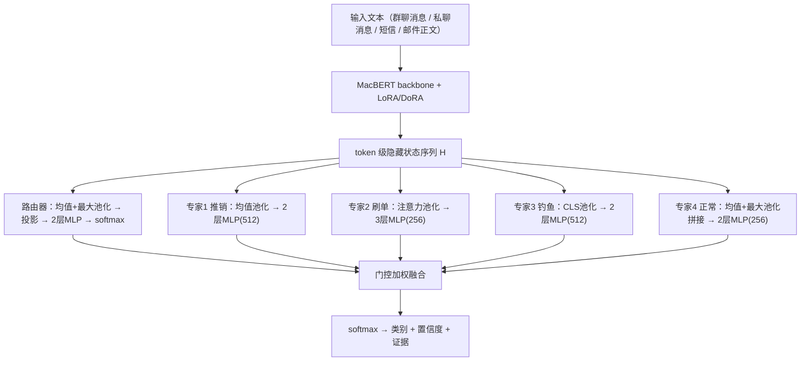
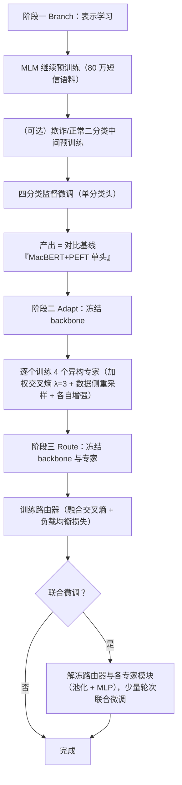

# 设计文档

## 题目背景

以本校为目标学校，针对本校学生经常遭受网络诈骗，且每年遭受网络诈骗的人数在全市中居高，公安部门和学校高度重视学校反诈工作。故以此题目进行研究。学校高发的诈骗类型为：

- **推销诈骗**：网络水军大量加入课程群、班级群，冒充老师、学长学姐私聊推销，或趁管理员不在线时在群内发布大量推销广告，甚至色情广告，常使用"已向群管理员报备"等迷惑性文本。
- **刷单诈骗**：通过群聊和私聊导流至恶意 App 或恶意网站，以小额返利诱导受害者，逐步升级任务。
- **冒充学校、教师的个人信息钓鱼**：通过群聊或泄露的个人邮箱发送诱导信息，诱导填写学号、身份证等敏感信息。

这三类诈骗在**话术风格和文本结构上存在显著差异**：推销诈骗话术口语化、碎片化，常含表情符号和"已报备"等迷惑性措辞；刷单诈骗呈现"小额返利→逐步升级"的渐进式语义结构；钓鱼信息则采用正式公文口吻，包含教务处/辅导员落款、结构化敏感信息索取等特征。这一观察构成了本系统核心技术路线的出发点。

三类诈骗的**共同载体是文本**（群聊消息、私聊消息、短信、邮件正文）。本系统只处理文本，不解析链接、不抓取网页、不做流量分析。

## 项目目标

- 使用中文 BERT（MacBERT）微调，采用 LoRA 家族算法（LoRA、DoRA）进行参数高效微调，并与全量微调对比。
- 使用 LLM API 大批量生成标注数据，弥补学校数据难以获取的缺口。
- **使用 MoE 风格的多专家门控融合架构，处理三类诈骗在话术风格上的显著差异**。这里的"多专家"不是标准 MoE 中的同构 FFN 专家，而是指针对不同诈骗类型话术特征训练的异构专家网络，由路由器根据输入消息的语义特征动态组合。
- **输入统一为纯文本**：群聊/私聊消息、短信、邮件正文。不解析 URL、不抓取网页、不含流量特征分析（范围决策理由见下文）。
- **数据获取约束**：只使用可直接下载的公开数据集，不依赖需要注册或申请的渠道；所有数据集经人工核实可用后统一打包为 Lance 格式进行训练。
- 与传统方案（TF-IDF + 朴素贝叶斯）对比验证，获取对比数据。
- 将模型接入校园社团群聊招新机器人（"蓝妹"），在真实场景中验证效果。
- 前端技术栈：pnpm + Vite + TypeScript + Vue + Pinia + TDesign。
- 模型运行时：ONNXRuntime。
- 训练平台：Python 3。数据集存储：Lance 格式。

## 总体设计

> **消歧义：本方案中的"多专家"与标准 MoE**
>
> 标准 MoE（Mixture of Experts，混合专家）通常指多个**同构专家网络**（同结构、同维度）处理同一类输入，由路由器选择或加权组合，典型实现是在 Transformer 的 FFN 层用多个 FFN 替代单个 FFN，路由器按 token 分配。本方案中的"专家"是**面向不同诈骗类型话术特征的异构专家网络**——它们共享 MacBERT 底层表示，但各自拥有独立的池化策略与分类头，输入类型相同（均为消息文本）。因此，本方案更准确的名称是"**多专家门控融合**"或"**MoE 风格的多专家路由**"，阅读时请将其理解为"多个专家对同一消息文本从不同话术特征角度进行判断，由路由器动态加权"，而不是把标准 MoE 层插入 BERT 中间层。

### 范围决策：为什么只做纯文本

本系统将输入严格限定为纯文本，不解析 URL、不抓取网页、不做流量分析。理由如下：

1. **课程定位**：课程要求"聚焦到解决一个非常具体的小问题"。三类校园诈骗的判定核心在文本话术本身，URL/站点信息只在少数消息中出现，限定文本后问题边界更清晰。
2. **工程可靠性**：恶意站点特征（HTML、SSL 证书、Whois 年龄、重定向链）依赖推理时联网，且恶意站点抓取必须隔离沙箱。课堂演示环境网络不可控，这些环节是现场失败的高危项。
3. **实验收益预期低**：真实输入中 95% 以上是纯文本消息。若引入辅助分支，其在绝大多数样本上走"缺失"路径，模型会学会忽略它，"去掉该分支"的消融大概率显示零差异，工程投入换不来可报告的数字。
4. **架构简化**：单一输入类型下，入口分类器、缺失嵌入机制、多分支特征注入层全部不需要，训练与推理链路保持单支路，系统的可实现性和可讲性显著提升。
5. **数据可得性**：与 URL/站点相关的公开数据集无法保证本地可稳定核实与使用（相关条目见"已剔除的候选数据集"）。

URL 相关的手工特征方法（规则匹配、黑名单）不进入本系统。课程要求的"传统方法对比"由 TF-IDF + 朴素贝叶斯/逻辑回归基线承担（见"效果验证"）。

### 多专家分工

本方案将 MoE 的"专家分工"思想体现在**诈骗类型维度**。三类诈骗在话术风格上的差异（口语化 vs 公文式 vs 渐进诱导式）为专家分工提供了天然的语义基础。每个专家专门学习某一类诈骗的话术模式，路由器根据消息的语义特征动态组合专家输出。这一设计有明确的研究先例支撑：

- **JMoE-FAP**（Shi et al., *Journal of Safety Science and Resilience*, 2025）将混合专家方法与点积注意力机制结合，在真实电信网络诈骗案件数据上进行受害过程分析，并发识别受害过程中的关键事件。这证明了"MoE + 欺诈文本"这一组合在中文反诈场景中的有效性。
- **CAMERA**（Pan et al., IJCAI 2026, arXiv:2605.20032）针对无监督文本图欺诈检测中的"语义伪装"问题，采用**自我解耦（ego-decoupled）的 MoE 架构**，每个专家专门建模一种不同类型的欺诈指示信号，再由上下文感知的门控模型自适应整合不同专家学到的线索。其"每个专家建模一种欺诈指示信号"的设计理念与本方案"每个专家学习一类诈骗话术"的思路高度一致。

### 专家异构性设计

为确保专家真正具有异构性而非简单的同构分类头，每个专家在**网络结构、池化策略、训练数据侧重**三个维度上差异化。**损失函数不参与异构化**：若不同专家使用不同的损失函数（如 Focal Loss、对比学习、标签平滑），各专家输出 logits 的尺度天然不可比，融合前必须引入额外的校准机制去修补，徒增脆弱性。因此所有专家统一使用加权交叉熵（定义见"数学形式化"），异构性只体现在结构与数据上。

由于各专家采用不同池化策略，专家层的输入是 backbone 的 **token 级隐藏状态序列** $H$（而非单一池化向量），各专家自行池化。这样设计的原因：池化策略本身就是专家"视角"的一部分——如果先把 $H$ 池化成单个向量再分发给所有专家，各专家的差异就只剩下 MLP 结构，"均值视角/注意力视角/全局视角"的分工便无从谈起。

| 差异化维度 | 推销诈骗专家 | 刷单诈骗专家 | 钓鱼诈骗专家 | 正常消息专家 |
| :--- | :--- | :--- | :--- | :--- |
| **网络结构** | 2 层 MLP，隐藏维度 512 | 3 层 MLP，隐藏维度 256 | 2 层 MLP，隐藏维度 512 | 2 层 MLP，隐藏维度 256 |
| **池化策略** | 均值池化 | 注意力池化（单头，可学习查询） | CLS token 表示 | 均值池化 + 最大池化拼接 |
| **训练数据侧重** | 推销类过采样 + 表情符号扰动 | 刷单类过采样 + 任务升级序列插入 | 钓鱼类过采样 + 公文格式变化 | 正常类 + 近领域负样本（"像诈骗的正常消息"） |
| **分工机制** | 对推销类损失加权 $\lambda=3$ | 对刷单类损失加权 $\lambda=3$ | 对钓鱼类损失加权 $\lambda=3$ | 对正常类损失加权 $\lambda=3$ |

池化策略即各专家的"视角"：均值池化捕捉整体语义分布，注意力池化聚焦高显著性片段（如返利数字、"已报备"短语），CLS 表示偏向全局公文式语义，均值+最大拼接兼顾平铺与峰值特征。

**类别加权是专家分工的显式机制**：每个专家都是完整的 $C$ 分类器（输出 $C=4$ 维 logits），但专家 $i$ 的训练损失对其负责的类别 $i$ 加权 $\lambda_{i,i}=3$（其余类别权重 1），配合数据侧重采样，使专家 $i$ 的参数被系统性优化以判别类别 $i$。若缺少这一机制，所有专家见到相同数据、相同损失，路由器将学成近似均匀权重，多专家门控融合退化成普通集成——这是本设计成立与否的关键点。

**实现绑定说明**：上表的专家排列顺序（推销/刷单/钓鱼/正常）是行文顺序；实现中专家与类别的绑定通过配置项 `experts[].self_class` 显式指定（推销→1、刷单→2、钓鱼→3、正常→0），与专家在配置文件中的列表顺序无关，避免"专家 $i$ 负责类别 $i$ 的下标巧合依赖"。推理服务的专家命名从导出元数据 `predict_meta.json` 读取。

### 整体架构



**消息主干**：以中文 BERT（MacBERT）为 backbone，使用 LoRA 或 DoRA 微调。训练数据来自公开数据集 + LLM 合成数据。输出为 token 级隐藏状态序列 $H$。

**多专家门控融合层**：系统核心创新点。$M$ 个专家网络（默认 $M=4$：推销诈骗专家、刷单诈骗专家、钓鱼诈骗专家、正常消息专家）对 $H$ 各自池化后独立判断，每个专家 $E_i$ 输出一个 $C$ 维 logits 向量 $z_i \in \mathbb{R}^C$（$C=4$）。路由器是一个小型 softmax 分类器，输出专家权重 $g \in \mathbb{R}^M$，门控融合层对专家 logits 加权求和。训练采用三阶段策略（见"训练策略"）。

**分类头/输出层**：融合 logits 经 softmax 输出四分类结果：正常、推销诈骗、刷单诈骗、钓鱼诈骗。同时输出置信度和证据字段：触发高风险的关键词（高亮 token 级贡献）、各专家门控权重、各专家独立给出的类别分数。

### 数学形式化

设 backbone 输出的 token 级隐藏状态序列为 $H = [h_1, \dots, h_L] \in \mathbb{R}^{L \times d}$（$d=768$），专家数量 $M=4$，类别数 $C=4$。

**专家输出**：每个专家先用自己的池化算子 $p_i(\cdot)$ 将 $H$ 池化为向量，再送入各自的 MLP：

$$
z_i = E_i\big(p_i(H)\big) \in \mathbb{R}^{C}
$$

其中 $p_1$ 为均值池化，$p_2$ 为注意力池化，$p_3$ 为 CLS 取值，$p_4$ 为均值与最大池化拼接（$p_4(H) \in \mathbb{R}^{2d}$，其余 $p_i(H) \in \mathbb{R}^{d}$）。

**路由器**：路由器使用均值+最大池化拼接作为输入（兼顾两种统计视角）：

$$
h_r = \big[\,p_{\text{mean}}(H);\, p_{\text{max}}(H)\,\big] \in \mathbb{R}^{2d}
$$

$$
u = \text{Dropout}\left(\text{LayerNorm}(W_p h_r + b_p)\right), \quad W_p \in \mathbb{R}^{d_r \times 2d}
$$

$$
g(h_r) = \text{softmax}\left(W_2 \cdot \text{ReLU}(W_1 u + b_1) + b_2\right)
$$

其中 $d_r = 256$ 为路由器内部维度，$W_1 \in \mathbb{R}^{d_r \times d_r}$，$W_2 \in \mathbb{R}^{M \times d_r}$。softmax 温度固定为 1（不引入温度调度，理由见"关于路由器温度"）。

**门控融合**：

$$
z = \sum_{i=1}^{M} g_i(h_r) \cdot z_i, \qquad \hat{y} = \text{softmax}(z)
$$

**分类损失**：所有专家与融合层统一使用加权交叉熵。这里有两种用途不同的权重，不要混淆：

- **全局类别权重 $w = (w_{\text{正}}, w_{\text{推}}, w_{\text{刷}}, w_{\text{钓}})$**：处理"正常消息远多于诈骗消息"的类别不平衡，作用于所有损失，与专家无关；
- **专家分工权重 $\lambda_{i,c}$**（$\lambda_{i,i}=3$，$\lambda_{i,c\neq i}=1$）：实现专家专门化，仅在阶段二各专家的独立训练中使用；阶段三对融合输出 $\hat{y}$ 计算损失时只使用全局类别权重 $w_c$。

专家 $i$ 在阶段二的损失为：

$$
\mathcal{L}_i = -\frac{1}{N}\sum_{n=1}^{N}\sum_{c=1}^{C} w_c \cdot \lambda_{i,c} \cdot y_{n,c}\log \hat{y}_{i,n,c}
$$

其中 $\hat{y}_{i} = \text{softmax}(z_i)$ 为专家 $i$ 独立的四分类概率。

**负载均衡损失**：采用 Switch Transformer 的辅助损失形式，区分"硬分配频率"与"软路由概率"。设 batch 内样本数为 $N$，$g^{(n)}$ 为路由器对第 $n$ 个样本的输出：

$$
f_i = \frac{1}{N}\sum_{n=1}^{N} \mathbb{1}\left[\arg\max_j \, g_j^{(n)} = i\right], \qquad
p_i = \frac{1}{N}\sum_{n=1}^{N} g_i^{(n)}
$$

$$
\mathcal{L}_{\text{bal}} = \alpha \cdot M \cdot \sum_{i=1}^{M} f_i \cdot p_i
$$

其中 $\alpha=0.01$，全程使用固定值；$f_i$ 由 argmax 统计得出、不参与梯度回传（梯度仅经 $p_i$ 流动），这是 Switch Transformer 辅助损失的标准做法。该损失鼓励路由器在硬分配频率和软概率两个维度上保持均衡，防止路由退化为"只选某一个专家"。

注意：**不使用 $f_i = p_i$ 的简化形式**，因为那会导致损失退化为 $\alpha M \sum_i g_i^2$，其最小值点在 $g$ 均匀分布处，反而抑制路由器按输入选择专家。训练中监控各专家激活比例 $f_i$ 和平均门控概率 $p_i$：若专家激活比例方差过大，可适当增大 $\alpha$；若正常类召回明显下降，可适当减小 $\alpha$。

总损失：

$$
\mathcal{L} = \mathcal{L}_{\text{cls}} + \mathcal{L}_{\text{bal}}
$$

**专家输出校准（可选的事后处理）**：由于统一使用交叉熵损失，各专家 logits 尺度天然可比，训练过程中不引入任何可学习温度参数。若训练后发现某个专家在融合中主导（门控权重与该专家单独性能不成比例），可在**验证集**上为每个专家拟合温度 $T_i$（最小化 NLL 的温度缩放，Guo et al., 2017），冻结后用于推理：

$$
\tilde{z}_i = \frac{z_i}{T_i}, \qquad z = \sum_{i=1}^{M} g_i \cdot \tilde{z}_i
$$

这是标准的事后校准手段，不进入训练循环，不增加训练脆弱性。

### 关于稀疏激活

本方案不采用稀疏激活（top-k 路由）。理由：$M=4$ 且每个专家仅约 0.5M–0.7M 参数（backbone 约 110M，相对可忽略），全激活的额外计算开销可忽略（单条消息推理成本主要在 backbone）；稀疏激活带来训练-推理不一致的风险，却不带来可测量的收益。若未来专家数量显著扩大，再引入 top-2 推理与训练期稀疏模拟不迟。

## BERT 模型选择与对比

### 候选模型和定量性能对比

候选模型均为开源中文 BERT 变体：

| 模型 | 核心特点 | 来源 |
| :--- | :--- | :--- |
| **hfl/chinese-roberta-wwm-ext** | RoBERTa 架构 + 全词掩码（Whole Word Masking），去除 NSP 任务，使用更大规模中文语料训练 | 哈工大讯飞联合实验室 |
| **hfl/chinese-macbert-base** | 将 MLM 掩码策略改为"近义词替换"，缓解预训练与微调阶段的不一致 | 哈工大 |
| **StructBERT (AliceMind)** | 通过打乱句子词序并让模型重建，显式建模词序和句法结构 | 阿里巴巴达摩院 |
| **ERNIE 3.0 Base** | 百度知识增强模型，引入实体关系知识 | 百度 |

以下数据来自公开评测和论文，用于建立性能预期。

**中文文本分类基准平均分**（AFQMC/TNEWS/IFLYTEK/CMNLI/CSL/WSC 六项平均，base 级别约 110M 参数）：

| 模型 | 平均分 |
|---|---|
| BERT-base-Chinese | 68.34 |
| RoBERTa-wwm-ext | 70.34 |
| **MacBERT** | **70.53** |

**中文情感/评论分类任务对比**：

| 模型 | Accuracy | F1-Score | AUC |
| :--- | :--- | :--- | :--- |
| BERT-base-Chinese | 85.23% | 84.33% | 0.901 |
| RoBERTa-wwm | 86.45% | 85.50% | 0.912 |
| ERNIE 3.0 | 87.12% | 86.30% | 0.919 |
| **MacBERT** | **87.68%** | **87.07%** | **0.924** |

**情感分类多模型对比**（10,000 条混合标注样本）：

| 模型 | 准确率 | F1 |
| :--- | :--- | :--- |
| BERT-base-chinese | 89.7% | 89.2% |
| RoBERTa-wwm-ext | 90.3% | 90.0% |
| ERNIE 3.0-base | 91.2% | 90.9% |
| **StructBERT-base** | **92.1%** | **91.8%** |

**电信诈骗案件分类任务（CCL23-Eval Task 6）**：

| 参赛方案 | 基座模型 | Macro-F1 |
| :--- | :--- | :--- |
| 某队伍 | Chinese-BERT-wwm-ext + FGM对抗训练 + 5折交叉融合 | 0.8602 |
| 某队伍 | ERNIE + 伪标签 + 模型融合 | 0.8628 |
| 某队伍 | Nezha + 对抗扰动 + EMA | 0.8625 |

三个方案得分非常接近（0.860–0.863），差距在统计噪声范围内。这说明在诈骗文本分类任务上，不同中文 BERT 变体之间的性能差异会被领域数据特性所"抹平"——关键在于训练策略（对抗训练、伪标签、模型融合）而非基座模型的微小差异。**这一结论同样适用于本方案的多专家架构：预期收益主要来自数据质量与训练策略，架构创新应定位为"实验性探索"而非"系统成立的前提"**（见"风险与预期管理"）。

### 模型选择

综上，我们选择 **MacBERT（hfl/chinese-macbert-base）** 为主力模型，**RoBERTa-wwm-ext（hfl/chinese-roberta-wwm-ext）** 为基线模型。

## 微调方法

我们选用 **LoRA 与 DoRA** 进行微调（DoRA 是 LoRA 的改进方案，二者是**替代关系**，不是叠加关系）。实际实验设置：

- 主模型：MacBERT + DoRA；
- 对比：MacBERT + LoRA；
- 消融：MacBERT + 全量微调。

LoRA（Low-Rank Adaptation）通过在预训练权重旁添加低秩矩阵来微调模型，大幅减少可训练参数量。其核心公式为：

$$
W = W_0 + \Delta W = W_0 + BA
$$

其中 $W_0 \in \mathbb{R}^{d \times k}$ 为冻结的预训练权重，$B \in \mathbb{R}^{d \times r}$，$A \in \mathbb{R}^{r \times k}$，秩 $r \ll \min(d, k)$。训练时只更新 $A$ 和 $B$，$W_0$ 保持不变。

DoRA（Weight-Decomposed Low-Rank Adaptation）将权重更新分解为幅度和方向两部分：

$$
W' = m \cdot \frac{W_0 + BA}{\|W_0 + BA\|_c}
$$

其中 $m$ 是可学习的幅度向量，$\| \cdot \|_c$ 表示列向量归一化。DoRA 在多个任务上一致提升 LoRA 1-2 个百分点，训练时间比 LoRA 略长（约 10-15%）。

**关于 PEFT 必要性的说明**：MacBERT-base 约 110M 参数，在单张消费级显卡上全量微调完全可行，本方案使用 LoRA/DoRA 并非算力所迫。将 PEFT 保留在实验矩阵中的价值是：(1) 对比 PEFT 与全量微调在诈骗文本这一小数据领域任务上的性能差异，本身是有意义的实验问题；(2) PEFT 合并后导出 ONNX 的部署流程与全量微调一致，参数量与推理延迟无差异；(3) 手写 LoRA 层对理解课程内容有直接教学价值。答辩被问"为什么不直接全量微调"时，按此口径回答。

### LLM 合成数据

BERT 本身已是预训练模型，再做自监督微调（MLM 任务）在有限数据规模下收益有限。我们转换思路，利用 LLM API 批量生成标注数据来对模型进行微调。可选用成本较低的 LLM API，例如 DeepSeek 系列或其他合规可用的中文大模型 API，具体型号以实际可用服务为准。可设计多组 prompt 模板，覆盖学校高发的三类诈骗（推销/刷单/钓鱼），每类生成数千条变体，再人工抽检若干条评估质量。

**合成数据合规与安全原则**：

- 只生成用于分类训练的"弱化、虚构、不可执行"样本。
- 不包含真实链接、真实学号、真实身份证、真实银行卡号。
- 不生成可直接用于实施诈骗的完整操作指南。
- 记录生成 prompt、过滤规则和人工审核记录。
- 使用敏感信息扫描、去重、多样性检查和人工抽检。
- 用 BERTScore 评估生成文本与真实样本的语义相似度，低于阈值的样本剔除。
- 人工抽检每类若干条，确保没有明显的"AI 味"（过于正式、结构雷同）。
- LLM API 调用应选择合规服务，避免敏感数据出境；合成数据只用于训练分类模型，不得对外发布为可直接使用的诈骗模板。
- 涉及"色情擦边广告"类变体时保持最小必要规模，遵守 LLM 服务商内容政策；若服务商拒绝生成，该子类以人工改写替代。

## 训练策略

### 三阶段方案（Branch–Adapt–Route）



三阶段训练流程的伪代码如下（以阶段二为例，展示专家分工机制的实现）：

```text
输入: 冻结的 backbone, 训练集 D = {(x_n, y_n)}, 专家数 M=4, 分工权重 λ=3
for i in 1..M:                          # 逐个训练专家
    初始化专家 E_i
    for epoch in 1..K:
        for 每个 mini-batch:
            H = backbone(x)             # backbone 冻结且处于 eval 模式（无 dropout 噪声）
            z_i = E_i(p_i(H))
            L = Σ_n w[y_n] · λ_{i,y_n} · CE(z_i, y_n)     # λ_{i,i}=3 实现分工
            反向传播并只更新 E_i 的参数
    在验证集上评估 E_i，保存最优权重并冻结
```

**阶段一：表示学习（Branch）**

- **MLM 继续预训练**：在 80 万条中文短信语料（hrwhisper/SpamMessage）上对 MacBERT 做继续预训练，使模型适配短信/消息文体。
- **（可选）欺诈/正常二分类中间预训练**：用 ChiFraud（欺诈/正常）等大规模二分类数据做一轮二分类适配后再进入四分类微调。此步骤不进入主路径，主要服务于消融 A5 的对照组。
- **四分类监督微调**：在带四分类标签的消息数据上，以**单分类头**进行监督微调（正常/推销/刷单/钓鱼）。
- **该单头模型同时就是对比实验中的"MacBERT+PEFT 单头"基线**——阶段一的产出不浪费，基线与完整系统共享同一 backbone，对比天然公平。阶段一直接做四分类微调的原因：专家层只是小型 MLP，其判别上限由 backbone 表示质量决定，四分类监督信号有助于学到任务对齐的表示（"阶段一有无四分类辅助"的影响由消融 A5 检验）。

**阶段二：专家训练（Adapt）**

- **冻结** backbone（含 LoRA/DoRA 权重）并置于 eval 模式（关闭其内部 dropout，保证表示确定性），在 token 级表示 $H$ 上逐个训练 $M=4$ 个异构专家。
- 每个专家按"专家异构性设计"中的配置训练：加权交叉熵（对自己负责的类别加权 $\lambda=3$）+ 数据侧重采样（WeightedRandomSampler 对负责类别约 3 倍过采样）+ 各自的数据增强。
- 训练数据中同时包含其他类别作为负例，保证每个专家能输出完整的 $C$ 维分数。
- 正常消息专家需要使用跨类型的正常样本训练，确保其能识别"看起来像诈骗但实际正常"的边界样本（例如正式的课程通知、内容严肃的社团公告、合法商家的正常推广）。

**阶段三：路由训练（Route）**

- **冻结**所有专家参数与 backbone，**训练路由器**（输入投影 + 2 层 MLP），用混合四类样本的数据训练，附加负载均衡损失 $\mathcal{L}_{\text{bal}}$（$\alpha=0.01$ 固定，全程使用）。
- **联合微调**：路由器训练稳定后，仅解冻路由器与各专家模块（各自的池化层与 MLP；注意注意力池化含可学习查询参数，必须随之解冻）做少量轮次联合微调，backbone 保持冻结，避免灾难性遗忘。
- **小规模原型验证**：先以 $M=4$ 跑通三阶段全流程，验证多专家门控融合相对单头基线的效果，再逐步扩充数据规模。

### 关于路由器温度

路由器 softmax 温度固定为 1，不引入温度调度（如从 1.0 退火至 0.5）。原因：温度调度与负载均衡损失的调控目标重叠——两者都在调节路由分布的尖锐程度——同时引入一个需要调度的超参数。路由分布的锐化交由负载均衡系数 $\alpha$ 统一调控，超参数更少，行为更可解释。

### MoE 直接插入 BERT 中间层的风险

本方案不将标准 MoE 层插入 BERT 中间层，而是放在输出融合层，对完整消息的语义表示进行专家分工。理由：

1. **路由震荡**：在 BERT 中间层插入 MoE，路由器在每个 Transformer 层都要做 token 级别的路由决策，训练初期路由权重剧烈变化，导致梯度不稳定。
2. **负载不均衡**：某些层的路由器可能将所有 token 分配给同一个专家，导致其他专家梯度消失。
3. **预训练权重破坏**：BERT 的中间层 FFN 是预训练好的，用 MoE 替换会破坏已有的表示能力。

输出层专家融合避开了上述全部风险，同时保留了"专家按话术类型分工 + 门控自适应组合"的核心思想，与 CAMERA 的输出级专家设计理念一致。

### 风险与预期管理

- **多专家融合可能不优于单头基线**。CCL23-Eval 的参赛数据显示，在诈骗文本任务上不同方案的差距常在统计噪声内。若完整系统相对"MacBERT+PEFT 单头"提升不显著（例如 Macro-F1 差距 < 1 个百分点），结论照实汇报：多专家架构的价值点转为**可解释性**（各专家权重可视化、按类型归因）与**消融分析**本身，这在课程报告中是完全站得住的学术叙事。
- **数据质量是第一风险**。真实标注数据现已覆盖多类来源（天池五分类、TeleAntiFraud 转写[人工审查后]、FGRC-SCD、anti_fraud_dataset、公开邮件数据集与 FBS 伪基站短信），四分类均有真实样本，但**刷单类仍最薄弱**（当前仅 139 段真实对话 + CCL2023 镜像的刷单返利类待下载），且 TeleAntiFraud 为通话话术、FGRC-SCD 由案件数据合成、CCL2023 为受害人笔录文体，与校园消息文体存在域偏移，模型可能过度适应非消息文体。缓解手段：真实数据优先混合训练、"真实→合成 / 合成→真实"两组跨域泛化实验、黄金测试集域偏移预检（见"数据集使用建议"）。这一取舍应在报告与答辩中如实说明。
- **课堂演示环境不可控**。演示系统必须支持完全离线运行（本地 ONNX 推理 + 预置样本兜底），并准备录屏备份。

## 数据集

### 数据集可用性核实说明

下表所列数据集均已于 **2026-10 逐一人工核实**（实际打开数据集页面/仓库确认存在性、许可证、下载条件）。标注：✅ 可直接下载；🔑 注册/授权后已获取。

**数据获取约束（2026-10-05 更新）**：项目启动时约定"只使用可直接下载的公开渠道，不依赖注册或申请"，作为降低获取风险的初始基线。**现该约束已放宽**：已完成天池账号注册与 TeleAntiFraud 的 gated 授权同意，两个数据集正式纳入使用（见下表与"TeleAntiFraud 转写提取"）。目录约定：原始数据存放 `rawdata/`，整理后的 Lance 数据集存放 `dataset/`。仍不使用：CCL23-Eval 任务 6（CodaLab 注册 + 人工审核）、DataCon2023 官方渠道（参赛注册），详见"已剔除的候选数据集及原因"。URL 与站点类数据集随纯文本范围决策不在使用范围内；无法核实存在的条目同样见"已剔除的候选数据集"。

### 核心中文诈骗/垃圾文本数据集

| 数据集 | 获取渠道 | 许可证 | 规模与说明 | 可用性 |
| :--- | :--- | :--- | :--- | :--- |
| **电信诈骗五分类（天池）** | 天池: [dataset/201837](https://tianchi.aliyun.com/dataset/201837)（已注册下载） | GPL-3.0（禁商用；使用需引用 Li, Zhang & Jiang, *Applied Sciences* 2024, 14, 11628） | 约 1.18 万条短信（去重后 11,556 条）：正常 7,773 + 冒充公检法/贷款/冒充客服/冒充领导熟人各 1,000。**钓鱼类真实样本主力之一**；其"正常"类多为运营商营销短信，恰好充当近领域负样本。原始数据 `rawdata/tianchi5/`（注意 label01–03 文件为 UTF-8、label04 为 GBK） | 🔑 |
| **TeleAntiFraud** | Hugging Face: [JimmyMa99/TeleAntiFraud](https://huggingface.co/datasets/JimmyMa99/TeleAntiFraud)（gated 已授权；ModelScope 版有审核限制不可用） | Apache 2.0（ACM MM 2025 论文数据集） | 公开版含 **13,711 个通话音频**（约 307 小时）+ 二分类标注（4,400 次通话，欺诈/正常各半）+ SFT 细分标注（客服/银行/钓鱼/投资/彩票/绑架/身份盗窃诈骗 + 7 类正常场景）。**公开文本部分不含转写**，话术原文经 ASR 提取（见"TeleAntiFraud 转写提取"）。原始数据 `rawdata/teleantifraud/` | 🔑 |
| **ChiFraud** | GitHub: [xuemingxxx/ChiFraud](https://github.com/xuemingxxx/ChiFraud)（COLING 2025 论文官方数据，Tang et al.） | CC BY-NC 4.0（禁商用） | 59,106 条专家标注欺诈文本 + 352,328 条正常文本；**实际为 11 类标签**（0=正常，1=赌博，2=色情，3=假证件，4=假银行卡，5=违禁药品，6=非法套现，7=非法认证，8=假SIM卡，9=地下贷款，10=新型），含按时间划分的 train/t2022/t2023 三个文件 | ✅ |
| **FGRC-SCD** | Hugging Face: [Abooooo/FGRC-SCD](https://huggingface.co/datasets/Abooooo/FGRC-SCD) | CC BY 4.0 | 中文风险短信与对话共约 35.3 万条（去重后），**风险类别与 CCL23 任务 6 的 12 类同一 taxonomy（已实查确认）**：无风险 13.9 万、冒充类 5.2 万、虚假购物服务 3.5 万、投资理财/信用服务等 12.6 万。**四分类监督主力之一** | ✅ |
| **CCL2023-Eval 任务 6** | 百度 AI Studio 公开镜像: [datasetdetail/215947](https://aistudio.baidu.com/datasetdetail/215947)（官方渠道 CodaLab 需注册审核，改用镜像） | 镜像页标注 CC0（以实际下载包为准） | 102,762 条案件描述、12 类，**刷单返利类 35,459 条为最大类——刷单类补充的关键来源**。文本为受害人笔录（第三人称），存在文体域偏移，该来源贡献需单独评估。下载放入 `rawdata/ccl2023/` 后自动入库 | ⏳ 待获取 |
| **anti_fraud_dataset** | Hugging Face: [quanshiyun/anti_fraud_dataset](https://huggingface.co/datasets/quanshiyun/anti_fraud_dataset) | GPL-3.0（教学项目无碍，勿与闭源代码混合分发） | 12 类经济诈骗对话 CSV（文件名即类型），2,212 段对话（按 case 聚合）。**刷单类真实样本来源之一**：兼职刷单诈骗 139 段→刷单；冒充客服诈骗 200 段→钓鱼；其余 10 类（杀猪盘/传销/投资等）话术差异大不映射 | ✅ |
| **垃圾短信数据集（80 万条）** | GitHub: [hrwhisper/SpamMessage](https://github.com/hrwhisper/SpamMessage) | 无许可证标注 | 约 80 万条中文短信（垃圾约 8 万 + 正常约 72 万），0/1 标签；数据较老（约 2016 年前），适合 MLM 继续预训练而非直接四分类 | ✅ |
| **FBS_SMS_Dataset** | GitHub: [Cypher-Z/FBS_SMS_Dataset](https://github.com/Cypher-Z/FBS_SMS_Dataset)（CCS 2020 论文 "Lies in the Air: Characterizing Fake-base-station Spam Ecosystem in China" 数据集，使用需引用论文并注明仓库） | 无正式许可证，需引用论文 | 约 14,000 条真实伪基站中文短信，14 类（含 AD:Loan、AD:Real_estate、FR:Phishing(Bank) 等），贴近校园推销诈骗场景 | ✅ |
| **ScamGen** | Mendeley Data: [DOI 10.17632/dkypjhkmgb.1](https://data.mendeley.com/datasets/dkypjhkmgb/1)（配套论文 Han et al., *Computers in Human Behavior*, 2024） | CC BY 4.0 | 中文电话诈骗语料，模板增强的**半合成**语料，标注 5 类诈骗意图（Official / Speculation / Imprudent / Relationship / Others） | ✅ |
| **SpamHunter** | GitHub: [opmusic/SpamHunter_dataset](https://github.com/opmusic/SpamHunter_dataset)（CCS 2022 论文 "Clues in Tweets: Twitter-Guided Discovery and Analysis of SMS Spam"） | 未标注 | 21,918 条多语言 SMS 垃圾消息（75 种语言）。**注意：中文不在 top-4 语言中（英 42%/印尼 25%/西 10%/荷 8%），中文部分预计不足 3,000 条**，仅作跨语言鲁棒性小规模补充，不作主力训练数据 | ✅ |

**使用定位**：80 万短信语料用于 MLM 继续预训练；ChiFraud 用于 MLM 之后的欺诈/正常二分类适配（及二分类正样本）；**天池五分类与 TeleAntiFraud（转写人工审查后）是四分类监督微调的真实样本主力**（钓鱼/正常类）；FGRC-SCD 与 anti_fraud_dataset 用于四分类监督微调与验证；FBS_SMS、ScamGen、SpamHunter 作为类型补充与鲁棒性/泛化评估。

### 钓鱼邮件文本数据集

| 数据集 | 获取渠道 | 许可证 | 规模与说明 | 可用性 |
| :--- | :--- | :--- | :--- | :--- |
| **LLMGen-Phishing-Email-Dataset** | Hugging Face: [Dizzzy0x00/LLMGen-Phishing-Email-Dataset](https://huggingface.co/datasets/Dizzzy0x00/LLMGen-Phishing-Email-Dataset) | Apache 2.0 | 实测 **6,776 条**（中文 3,030 条由 DeepSeek 生成 + 英文 3,746 条由 OpenAI 生成），二分类 content/label，与"冒充学校钓鱼"场景直接对应 | ✅ |
| **PhishMMF** | GitHub: [12345677876/PhishMMF](https://github.com/12345677876/PhishMMF) | MIT | 含原始邮件文本。其中 datacon2023 部分 3,000 封**中文钓鱼邮件**（自带 label=1，去重后 783 独特文本，群发副本多）→ 钓鱼；CEAS_08/SpamAssasin 英文正常邮件 6,000 封 → -1（跨语言用）；all.jsonl 为特征向量不使用 | ✅ |
| **Phishing Email Curated Datasets** | Zenodo: [record 8339691](https://zenodo.org/records/8339691)（DOI 10.5281/zenodo.8339691） | CC BY 4.0 | 11 个经典数据集合集（TREC 05/06/07、CEAS_08、Enron、SpamAssassin、Nazario、Nigerian Fraud、Ling 等），共约 449MB，1995–2022。**内容基本全为英文**，用于跨语言泛化实验，不进入中文训练主力 | ✅ |

### 标签映射

每个数据集拿到后先做标签映射表并记录在数据卡中。映射原则：**宁缺毋滥**——话术类型差异大的样本不强行映射，避免引入标签噪声。四分类标签定义：0=正常，1=推销，2=刷单，3=钓鱼；-1 表示不映射（仅用于二分类/预训练）。

| 来源数据集 | → 正常 | → 推销 | → 刷单 | → 钓鱼 | 不映射（另作他用） |
| :--- | :--- | :--- | :--- | :--- | :--- |
| **天池五分类**（label00–04 文件） | label00（正常文本，多为运营商营销短信=近领域负样本） | — | — | label01 冒充公检法、label03 冒充客服、label04 冒充领导熟人 | label02 贷款、代办信用卡（与刷单话术差异大，仅作二分类/预训练正样本） |
| **TeleAntiFraud**（转写审查后） | 7 类正常场景通话（订餐/打车/外卖/咨询客服/预约/购物/交通） | — | — | 客服诈骗、银行诈骗、钓鱼诈骗、身份盗窃 | 投资诈骗、彩票诈骗、绑架诈骗（话术差异大）；无细分标注的 fraud 仅作二分类正样本 |
| ChiFraud（11 类） | 正常类 | — | — | — | 全部欺诈类仅用于**二分类预训练**（欺诈/正常），11 类与校园三类话术差异大，不强行细粒度映射 |
| FGRC-SCD | 无风险（短信+对话） | 虚假购物、服务类（可选映射，消融可按 subtype 剔除） | — | 冒充电商物流客服/公检法/领导熟人/军警购物 4 类 | 虚假网络投资理财、虚假信用服务、网络婚恋交友、网黑案件 |
| CCL2023-Eval 任务 6 | — | 虚假购物服务类（可选） | **刷单返利类 35,459 条** | 冒充 4 类 | 投资理财、信用服务、婚恋交友、网黑案件 |
| anti_fraud_dataset | — | — | 兼职刷单诈骗（139 段） | 冒充客服诈骗（200 段） | 杀猪盘、传销、投资、赌博、贷款、虚假购物、二手交易、微商代理、短信诈骗、虚拟货币 10 类 |
| FBS_SMS（14 类） | — | AD_Loan/AD_Retail/AD_Real_estate/AD_Network_service/AD_Other | — | FR_Phishing(Bank)/(Other) | FR_Financial、FR_Other、IL_*（赌博、发票等非法类）、Other |
| LLMGen-Phishing | label 0（中文部分） | — | — | label 1（中文部分） | 英文部分（GPT 生成，跨语言用） |
| PhishMMF | — | — | — | datacon2023 中文钓鱼邮件（label=1） | CEAS_08/SpamAssasin 英文正常邮件（label=0，跨语言用） |
| spam10000（reatiny，gated 已授权） | label 0（群聊闲聊） | label 1（群聊推广：色情引流/扣号/代刷话术，与校园"推销甚至色情广告"定义吻合） | — | — | spam 中混有少量赌博类推广，无细分标签 |
| LLM 合成数据 | 按生成模板 | 按模板 | 按模板 | 按模板 | — |

### TeleAntiFraud 转写提取（ASR）

TeleAntiFraud 公开版的话术原文在音频中，需先做语音转写。流程已由 `scripts/asr_teleantifraud.py` 验证：

- **模型**：FunASR SenseVoiceSmall + fsmn-vad（中文识别，RTF ≈ 0.011；单卡 RTX 4060 全量 13,711 条约 2–4 小时）。MP3 先经 ffmpeg 统一转 16 kHz 单声道 WAV 再送入模型。
- **审查闸门**：转写为机器生成，**全部行标记 `split=asr_review`、不进入训练**；人工审查通过后重新生成分划，方可并入 train/val/test。
- **审查要点**：(1) ASR 错字是否影响话术语义；(2) 细分类型标注与转写内容是否一致（防标注噪声）；(3) 是否含真实姓名/号码等需要脱敏的内容。
- 转写结果缓存于 `tmp/teleantifraud_asr.jsonl`（含音频时长），断点续传，可随时中断重跑。

### 校园风格黄金测试集

公开数据集与校园真实场景之间存在域偏移，这是本项目最大的数据风险。为此构建一个**绝不进入训练**的黄金测试集：

- 规模约 200 条：正常 / 推销 / 刷单 / 钓鱼各约 50 条；
- 来源：本校真实群聊消息截图（脱敏改写）+ 人工撰写 + LLM 生成后人工逐条修改，确保贴近校园真实话术（课程群推销、"已报备"话术、教务处落款邮件等）；
- 用途：(1) 项目启动期用它对所有候选模型做零成本预检，评估域偏移严重程度；(2) 最终汇报的主评测表在此测试集与公开测试集上分别报告，展示跨域泛化能力。

### LLM 合成数据策略

| 诈骗类型 | 生成目标 | 变体维度 |
| :--- | :--- | :--- |
| 推销诈骗 | 4k 条 | 冒充学长/学姐/老师；已报备/限时优惠话术；色情擦边广告变体（最小必要规模） |
| 刷单诈骗 | 4k 条 | 导流到 App/网站/QQ群；小额返利诱导；任务升级话术 |
| 钓鱼信息 | 3k 条 | 冒充教务处/辅导员/图书馆；学号/身份证/银行卡索取；伪造官方口吻 |
| 正常消息 | 10k 条 | 课程通知、社团活动、日常闲聊、学术讨论；**额外生成"近领域正常消息"**（正式通知、含链接的正常学术邮件、合法商家推广），专用于训练与评估模型区分"像诈骗但实际正常"的能力 |

质量过滤与安全过滤原则见"LLM 合成数据"一节。

### 已剔除的候选数据集及原因

核实过程中发现以下数据集不纳入使用范围。**引用前请勿使用**，答辩被问及时按此表口径回答。

| 数据集 | 原因 |
| :--- | :--- |
| TeleAntiFraud 2.0（arXiv:2609.18748） | 论文真实存在，但截至核实日无公开数据集页面，仅有临时匿名审稿仓库，数据不可稳定获取 |
| DataCon2023 邮件安全赛道 | 官方渠道需参赛注册、赛后开放状态未确认；第三方镜像无标签。按本项目数据获取约束不使用（带标签的钓鱼邮件需求由 LLMGen-Phishing 与 PhishMMF 覆盖） |

> 注：原列于此的**天池五分类**与 **TeleAntiFraud 1.0** 已于 2026-10-05 完成注册/授权，纳入使用，移至上文核心数据集表。
| ScamBench Training Corpus（网络流传"HF, 2026, CC-BY-SA-4.0, 14 语言含中文"） | 不存在。Hugging Face 全站仅有一个韩语数据集 ScamBench-KR（1K–10K，MIT），规模、语言、许可证均不符 |
| 互联网诈骗检测数据集（网络流传"聚合数据 juhe.cn, 24,000 条多语言"） | 未找到。juhe.cn 数据集频道实查无此产品，多渠道交叉检索无任何匹配，高度疑似虚构 |
| SEAR（ACM MM 2025，[INSLabCN/SEAR-Dataset](https://github.com/INSLabCN/SEAR-Dataset)，MIT） | 数据真实存在，但内容为 AR 视觉/音频多模态社交工程实验数据，超出本项目纯文本范围，且 180 段对话规模有限 |
| MMS-VQA（SSRN 预印本 GRPO-MMS） | 论文真实存在，但数据集公开下载渠道无法验证，且为图文多模态数据，超出本项目范围 |
| URL 与站点类数据集（PhishTank、OpenPhish、URLhaus、Tranco、Common Crawl 及多模态数据集中的 URL/网页模态等） | 随纯文本范围决策一并排除 |

### 数据集格式

使用 **Lance** 作为主要格式。Lance 是一种列式数据格式，支持随机读取和全局 shuffle，适合大规模训练数据管理。字段设计如下：

| 字段 | 类型 | 说明 |
| :--- | :--- | :--- |
| `id` | string | 样本唯一 ID |
| `text` | string | 消息文本、短信、邮件正文（已脱敏） |
| `label` | int | 0 正常，1 推销，2 刷单，3 钓鱼；-1 表示未映射（仅用于二分类/预训练） |
| `subtype` | string | 细分类型 |
| `source` | string | 数据来源，如 chifraud/fgrc_scd/fbs/llm/golden |
| `split` | string | train/val/test |
| `meta` | json | 额外信息，如原始数据集原生标签、脱敏记录、合成模板 ID |

### 数据集使用建议

- **统一格式**：各数据集经 `scripts/build_processed.py` 解析 → 标签映射 → 去重 → 分层划分，产出 `data/processed/*.jsonl` 与 `dataset/*.lance`；原始数据保留在 `rawdata/` 不改动。天池五分类的 CSV 编码不一（label01–03 为 UTF-8、label04 为 GBK），脚本已按文件探测处理。
- **标签映射先行**：按上表执行并记录数据卡。
- **时间与来源划分**：诈骗话术随时间变化，测试集应尽量晚于训练集（ChiFraud 自带按时间的 t2022/t2023 划分可直接利用）。跨数据集评估时以整个数据集为单位划分，避免同源文本泄漏。
- **合成数据隔离**：合成数据与真实数据分开记录 `source`，做"真实训练→合成测试"与"合成训练→真实测试"两组跨域泛化实验。
- **去重与风格检测**：多个 LLM 生成数据集之间可能存在话术模板重叠（特别是 LLMGen-Phishing 与本项目自建合成数据之间），用 MinHash 或嵌入相似度做跨数据集去重，避免训练集和测试集泄漏。
- **真实数据为主、合成数据为辅**：尽量将真实脱敏消息、邮件与合成数据混合训练。
- **类别不平衡处理**：正常消息通常远多于诈骗消息，通过全局类权重 $w_c$ 与重采样处理（已纳入损失定义；不使用 Focal Loss，保证各专家损失形式统一、logits 尺度可比）。
- **多语言数据的筛选**：SpamHunter、Zenodo 邮件合集等先筛选中文部分进入训练；非中文部分仅用于跨语言泛化实验。

## 效果验证

效果验证从对比验证和实际场景验证两方面进行。对比验证证明模型优于传统方法并量化各组件贡献，实际场景验证证明系统有实用价值。

### 对比验证

#### 对比方案

所有方案输入完全一致（纯文本），共享同一数据划分，直接对比：

| 方案 | 说明 | 角色 |
| :--- | :--- | :--- |
| **基线 1** | TF-IDF（unigram + bigram）+ 朴素贝叶斯 | 传统方法 |
| **基线 2** | TF-IDF + Logistic Regression | 传统方法 |
| **主模型 A** | MacBERT + 全量微调（单分类头） | 深度学习对照 |
| **主模型 B** | MacBERT + LoRA（单分类头） | PEFT 对照 |
| **主模型 C** | MacBERT + DoRA（单分类头，即阶段一产物） | 主模型基线 |
| **完整系统** | MacBERT + DoRA + 多专家门控融合（$M=4$） | 核心贡献 |

#### 消融实验

| 消融 | 设置 | 回答的问题 |
| :--- | :--- | :--- |
| **A1** | 门控加权融合 → 专家 logits **等权平均** | 路由器是否学到了有效的动态权重 |
| **A2** | 门控加权融合 → **top-1 硬选择**（只取权重最大专家） | 软融合是否必要 |
| **A3** | 专家异构（结构/池化/数据侧重不同） → 专家同构（同结构同配置） | 异构设计是否有价值 |
| **A4** | $M=4$（三类诈骗 + 正常）→ $M=2$（诈骗 vs 正常二分类后接细分） | 按诈骗类型分工是否必要 |
| **A5** | 阶段一「MLM +（可选二分类）+ 四分类微调」（主路径） vs 「MLM + 二分类预训练、四分类能力完全交给专家层」 | 表示学习阶段监督信号的影响 |
| **A6** | 纯真实数据训练 → 真实 + LLM 合成混合训练 | 合成数据的真实贡献 |

（LoRA / DoRA / 全量微调的对比已包含在对比方案中，不重复设置。）

#### 评估维度

| 维度 | 指标 | 说明 |
| :--- | :--- | :--- |
| 整体性能 | Accuracy, Macro-F1, AUC | 三类诈骗 vs 正常的四分类 |
| 按诈骗类型细分 | 每类 Precision/Recall | 看模型是否对某类特别弱 |
| 泛化能力 | 在 LLM 合成数据上的表现 | 评估模型对 AI 生成诈骗的鲁棒性 |
| 跨数据集泛化 | 在未参与训练的数据集上的 F1 | 验证不是只记住某个数据集 |
| 对抗鲁棒性 | 谐音、变体字、emoji 插入、同义改写后的 F1 | 验证真实对抗场景 |
| 路由效率 | 各专家激活比例 $f_i$ 与平均门控概率 $p_i$ | 验证路由器是否按预期路由 |
| 近领域负样本表现 | 在"像诈骗的正常消息"（合成近领域样本 + 黄金测试集）上的误报率 | 验证模型能否区分易混淆的边界样本 |
| 推理延迟 | 单条消息端到端耗时 | 对比 TF-IDF 基线的速度差异 |
| 统计显著性 | 置信区间、McNemar 检验 | 验证提升不是随机波动 |
| 可解释性 | 门控权重与证据字段 | 展示各专家对最终判断的贡献 |
| 校准与拒识 | ECE、可靠性图、拒识率、覆盖率 | 验证置信度是否可靠，低置信度消息是否应转人工 |

**校准误差 ECE** 定义为：

$$
\text{ECE} = \sum_{k=1}^{K} \frac{|\mathcal{B}_k|}{N} \left| \text{acc}(\mathcal{B}_k) - \text{conf}(\mathcal{B}_k) \right|
$$

其中 $\mathcal{B}_k$ 为第 $k$ 个置信度区间内的样本集合（$K$ 为区间数，与专家数量 $M$ 无关），$\text{acc}(\mathcal{B}_k)$ 为该区间准确率，$\text{conf}(\mathcal{B}_k)$ 为该区间平均置信度。低置信度消息可转人工复核，并报告拒识率与覆盖率。

#### 公平评估原则

所有方案输入完全一致（纯文本），公平性只需保证：

- 所有方案使用**完全相同的数据划分**（同一 train/val/test 切分文件）；
- 传统基线与深度模型使用同样的文本预处理边界（如是否去 emoji，两组都报告）；
- 报告均值 ± 标准差（3 次不同随机种子）与 McNemar 检验，而非单次最优结果。

### 实际场景验证

借助蓝山工作室的招新机器人"蓝妹"，给蓝妹接入反诈模型，在真实场景中进行测试，验证其效果。

实际测试时保证：
- 群内告知并取得成员同意
- 不存储原始敏感消息，只存脱敏特征
- 提供人工复核和申诉机制
- 先小流量灰度测试，再逐步扩大

## 技术实现与系统集成

### 技术栈

- **前端**：pnpm + Vite + TypeScript + Vue + Pinia + TDesign + Vue-ECharts。
- **模型运行时**：ONNXRuntime。将微调后的 MacBERT（LoRA/DoRA 权重合并后）与专家层整体导出为一个 ONNX 图，用 ONNXRuntime 在 CPU 上推理。单条消息推理约 50-150ms，对群聊消息实时检测足够。并发量高时加消息队列做批量推理。
- **训练平台**：Python 3（PyTorch + transformers + peft）。
- **数据集存储**：Lance 格式。

**部署延迟说明**：

- 单一实时路径：纯文本输入，目标单条 50-150ms。
- 优化手段：ONNX int8 动态量化、高频文本哈希缓存、批处理、消息队列。

**安全与合规说明**：

- 不存储用户敏感信息，消息样本入库前脱敏；
- 记录审计日志，支持人工复核；
- LLM API 调用应选择合规服务，避免敏感数据出境；
- 群聊测试需获得成员知情同意，并提供退出和申诉机制。

### C 端展示设计

使用 Web 技术，实现三个界面：

- **用户操作页面**：用户直接在该页面粘贴文本提交检测，是供老师测试的主页面。支持单条检测与批量粘贴。
- **实时监控面板**：以时间线展示最近检测的消息，每条消息显示风险标签（颜色标注：绿/黄/红），点击可展开查看：触发高风险的关键词高亮、四个专家各自的门控权重与独立判断、路由器融合后的最终置信度。这是向课程展示多专家门控融合可解释性的核心界面。
- **统计仪表盘**：按诈骗类型统计检测数量、按时间段统计风险趋势、误报率统计。用 Vue-ECharts 图表组件展示。

### 与蓝妹集成

直接在 QQ 群内进行测试。集成方式：

1. 蓝妹收到群消息后，调用反诈识别 API
2. API 返回风险等级、诈骗类型、置信度和证据
3. 蓝妹根据风险等级决定是否提醒、折叠或上报
4. 高风险消息进入人工复核队列
5. 所有测试均在获得群成员知情同意的前提下进行

## 附录：术语表

| 术语 | 解释 |
| :--- | :--- |
| **BERT** | Bidirectional Encoder Representations from Transformers，双向 Transformer 编码器，通过 MLM 和 NSP 预训练 |
| **RoBERTa** | BERT 的改进版，去除 NSP，使用动态掩码和更大规模数据 |
| **MacBERT** | 使用近义词替换 MLM 掩码的中文 BERT 变体 |
| **StructBERT** | 通过词序重建任务增强结构理解的中文 BERT 变体 |
| **LoRA** | Low-Rank Adaptation，低秩适配，通过低秩矩阵微调预训练权重 |
| **DoRA** | Weight-Decomposed Low-Rank Adaptation，将权重更新分解为幅度和方向，是 LoRA 的改进方案 |
| **MoE** | Mixture of Experts，混合专家。标准 MoE 通常指同构专家 + 路由器；本方案中指面向不同诈骗类型话术特征的异构专家门控融合 |
| **多专家门控融合** | 用路由器为不同专家网络分配权重，再加权求和。本方案中专指按诈骗类型分工的专家融合 |
| **异构专家** | 网络结构、池化策略或训练数据侧重不同的专家。本方案中专家在结构、池化、数据侧重维度均有差异，损失函数统一 |
| **类别加权 λ** | 专家 $i$ 训练时对自己负责类别的损失加权（$\lambda=3$），是专家分工的显式机制 |
| **负载均衡损失** | 鼓励路由器不要把全部样本都分配给同一个专家的正则项，采用 Switch Transformer 的硬分配频率 $f_i$ × 软路由概率 $p_i$ 形式 |
| **温度缩放** | 事后校准手段：在验证集上为模型输出拟合温度参数以最小化 NLL（Guo et al., 2017）。本方案中仅作为专家主导问题的可选补救 |
| **近领域负样本** | 与诈骗样本在主题或风格上接近的正常样本（如正式课程通知、合法推广），用于训练与评估模型在易混淆条件下的判别能力 |
| **黄金测试集** | 本项目人工构建的 200 条校园风格测试集，绝不进入训练，用于域偏移预检与最终汇报 |
| **ECE** | Expected Calibration Error，期望校准误差，用于衡量置信度与准确率的一致性 |
| **Lance** | 一种列式数据格式，支持随机读取和全局 shuffle |
| **ONNXRuntime** | 跨平台机器学习推理引擎，支持 ONNX 格式模型 |
| **ChiFraud** | COLING 2025 发布的中文欺诈文本数据集，59,106 条专家标注欺诈文本（11 类）+ 352,328 条正常文本 |
| **天池五分类** | 电信诈骗短信五分类数据集（天池 dataset/201837，GPL-3.0）：正常/冒充公检法/贷款/冒充客服/冒充领导熟人，本项目钓鱼类真实样本主力之一 |
| **TeleAntiFraud** | 音频-文本电信诈骗数据集（ACM MM 2025，Apache 2.0）；本项目用其通话音频经 ASR 转写后的文本与细分类型标注 |
| **SenseVoiceSmall** | 阿里 FunASR 开源中文语音识别模型（配合 fsmn-vad），本项目用于 TeleAntiFraud 通话转写，RTF ≈ 0.011 |
| **FGRC-SCD** | 基于真实电信诈骗案件数据合成的中文风险短信与对话数据集（HF: Abooooo/FGRC-SCD），本项目四分类监督主力数据之一 |
| **钓鱼邮件数据集** | 本项目使用的三个可直接下载的钓鱼邮件来源：LLMGen-Phishing（6,776 条，中文 3,030）、PhishMMF（11,672 条，含原始文本）、Zenodo 经典合集（全英文，跨语言泛化用） |
| **TF-IDF** | Term Frequency-Inverse Document Frequency，词频-逆文档频率 |
| **McNemar 检验** | 比较两个模型在同一测试集上预测差异是否显著的统计检验 |

## 附录：公式表

**自注意力**：

$$
\text{Attention}(Q, K, V) = \text{softmax}\left(\frac{QK^T}{\sqrt{d_k}}\right)V
$$

**LoRA**：

$$
W = W_0 + BA, \quad W_0 \in \mathbb{R}^{d \times k},\ B \in \mathbb{R}^{d \times r},\ A \in \mathbb{R}^{r \times k},\ r \ll \min(d, k)
$$

**DoRA**：

$$
W' = m \cdot \frac{W_0 + BA}{\|W_0 + BA\|_c}
$$

其中 $m$ 为可学习幅度向量，$\| \cdot \|_c$ 为列归一化。

**专家池化与输出**：

$$
z_i = E_i\big(p_i(H)\big) \in \mathbb{R}^{C}, \quad i = 1,\dots,M
$$

$p_1$ 均值池化、$p_2$ 注意力池化、$p_3$ CLS、$p_4$ 均值+最大拼接。

**路由器输入**：

$$
h_r = \big[\,p_{\text{mean}}(H);\, p_{\text{max}}(H)\,\big] \in \mathbb{R}^{2d}
$$

**路由器输出**：

$$
u = \text{Dropout}\left(\text{LayerNorm}(W_p h_r + b_p)\right)
$$

$$
g(h_r) = \text{softmax}\left(W_2 \cdot \text{ReLU}(W_1 u + b_1) + b_2\right)
$$

**门控融合**：

$$
z = \sum_{i=1}^{M} g_i(h_r) \cdot z_i, \qquad \hat{y} = \text{softmax}(z)
$$

**可选的事后温度缩放**（验证集拟合，冻结使用）：

$$
\tilde{z}_i = \frac{z_i}{T_i}, \qquad z = \sum_{i=1}^{M} g_i \cdot \tilde{z}_i
$$

**专家 $i$ 的加权交叉熵损失**：

$$
\mathcal{L}_i = -\frac{1}{N}\sum_{n=1}^{N}\sum_{c=1}^{C} w_c \cdot \lambda_{i,c} \cdot y_{n,c}\log \hat{y}_{i,n,c}
$$

其中 $w_c$ 为全局类别权重（处理不平衡），$\lambda_{i,i}=3$、$\lambda_{i,c\neq i}=1$（专家分工）。

**负载均衡损失**：

$$
f_i = \frac{1}{N}\sum_{n=1}^{N} \mathbb{1}\left[\arg\max_j \, g_j^{(n)} = i\right], \qquad
p_i = \frac{1}{N}\sum_{n=1}^{N} g_i^{(n)}
$$

$$
\mathcal{L}_{\text{bal}} = \alpha \cdot M \cdot \sum_{i=1}^{M} f_i \cdot p_i, \quad \alpha = 0.01
$$

**总损失**：

$$
\mathcal{L} = \mathcal{L}_{\text{cls}} + \mathcal{L}_{\text{bal}}
$$

**校准误差 ECE**（$K$ 为置信度区间数，与专家数量 $M$ 无关）：

$$
\text{ECE} = \sum_{k=1}^{K} \frac{|\mathcal{B}_k|}{N} \left| \text{acc}(\mathcal{B}_k) - \text{conf}(\mathcal{B}_k) \right|
$$

## 附录：参考文献

**论文**

1. Cui, Y., Che, W., Liu, T., Qin, B., & Yang, Z. (2020). *Revisiting Pre-Trained Models for Chinese Natural Language Processing*. Findings of EMNLP 2020.（MacBERT / RoBERTa-wwm）
2. Hu, E. J., et al. (2022). *LoRA: Low-Rank Adaptation of Large Language Models*. ICLR 2022.
3. Liu, S.-Y., Wang, C.-Y., Yin, H., Molchanov, P., Wang, Y.-C. F., Cheng, K.-T., & Chen, M.-H. (2024). *DoRA: Weight-Decomposed Low-Rank Adaptation*. ICML 2024.
4. Fedus, W., Zoph, B., & Shazeer, N. (2022). *Switch Transformers: Scaling to Trillion Parameter Models with Simple and Efficient Sparsity*. JMLR 23(120).（负载均衡损失形式）
5. Guo, C., Pleiss, G., Sun, Y., & Weinberger, K. Q. (2017). *On Calibration of Modern Neural Networks*. ICML 2017.（温度缩放与 ECE）
6. Shi, T., Hu, J., Li, D., & Chen, M. (2025). *JMoE-FAP: A Novel Model for Telecom Network Fraud Victimization Pattern Analysis*. Journal of Safety Science and Resilience. [ScienceDirect](https://www.sciencedirect.com/science/article/pii/S2666449625000246)
7. Pan, J., et al. (2026). *CAMERA: Adapting to Semantic Camouflage in Unsupervised Text-Attributed Graph Fraud Detection*. IJCAI 2026. [arXiv:2605.20032](https://arxiv.org/abs/2605.20032)
8. Tang, M., Wang, W., Cui, S., et al. (2025). *ChiFraud: A Long-term Web Text Dataset for Chinese Fraud Detection*. COLING 2025. [ACL Anthology](https://aclanthology.org/2025.coling-main.398)
9. Zhang, Y., et al. (2020). *Lies in the Air: Characterizing Fake-base-station Spam Ecosystem in China*. ACM CCS 2020.（FBS_SMS_Dataset）
10. Tang, S., Mi, X., Li, Y., Wang, X., & Chen, K. (2022). *Clues in Tweets: Twitter-Guided Discovery and Analysis of SMS Spam*. ACM CCS 2022.（SpamHunter）[arXiv:2204.01233](https://arxiv.org/abs/2204.01233)
11. Han, X., Qi, Y., Cao, H. B., Li, Q., Pedrycz, W., & Wang, W. (2024). *ScamGen: Unveiling psychological patterns in tele-scam through advanced template-augmented corpus generation*. Computers in Human Behavior 162.
12. Ma, Z., et al. (2025). *TeleAntiFraud-28k: A Audio-Text Slow-Thinking Dataset for Telecom Fraud Detection*. ACM MM 2025. [arXiv:2503.24115](https://arxiv.org/abs/2503.24115)
13. Li, J., Zhang, C., & Jiang, L. (2024). *Innovative Telecom Fraud Detection: A New Dataset and an Advanced Model with RoBERTa and Dual Loss Functions*. Applied Sciences 14(24), 11628.（天池五分类数据集配套论文）

**数据集来源**

- 电信诈骗五分类（天池）：[tianchi.aliyun.com/dataset/201837](https://tianchi.aliyun.com/dataset/201837)（GPL-3.0，需引用 Appl. Sci. 2024 论文）
- TeleAntiFraud：[huggingface.co/datasets/JimmyMa99/TeleAntiFraud](https://huggingface.co/datasets/JimmyMa99/TeleAntiFraud)（Apache 2.0，gated 已授权）
- ChiFraud：[github.com/xuemingxxx/ChiFraud](https://github.com/xuemingxxx/ChiFraud)（CC BY-NC 4.0）
- 垃圾短信 80 万条：[github.com/hrwhisper/SpamMessage](https://github.com/hrwhisper/SpamMessage)
- FBS_SMS_Dataset：[github.com/Cypher-Z/FBS_SMS_Dataset](https://github.com/Cypher-Z/FBS_SMS_Dataset)（CCS 2020，使用需引用论文）
- SpamHunter：[github.com/opmusic/SpamHunter_dataset](https://github.com/opmusic/SpamHunter_dataset)（CCS 2022）
- FGRC-SCD：[huggingface.co/datasets/Abooooo/FGRC-SCD](https://huggingface.co/datasets/Abooooo/FGRC-SCD)（CC BY 4.0）
- anti_fraud_dataset：[huggingface.co/datasets/quanshiyun/anti_fraud_dataset](https://huggingface.co/datasets/quanshiyun/anti_fraud_dataset)（GPL-3.0）
- LLMGen-Phishing-Email-Dataset：[huggingface.co/datasets/Dizzzy0x00/LLMGen-Phishing-Email-Dataset](https://huggingface.co/datasets/Dizzzy0x00/LLMGen-Phishing-Email-Dataset)（Apache 2.0）
- PhishMMF：[github.com/12345677876/PhishMMF](https://github.com/12345677876/PhishMMF)（MIT）
- ScamGen：[data.mendeley.com/datasets/dkypjhkmgb/1](https://data.mendeley.com/datasets/dkypjhkmgb/1)（DOI 10.17632/dkypjhkmgb.1，CC BY 4.0）
- Phishing Email Curated Datasets：[zenodo.org/records/8339691](https://zenodo.org/records/8339691)（DOI 10.5281/zenodo.8339691，CC BY 4.0）
